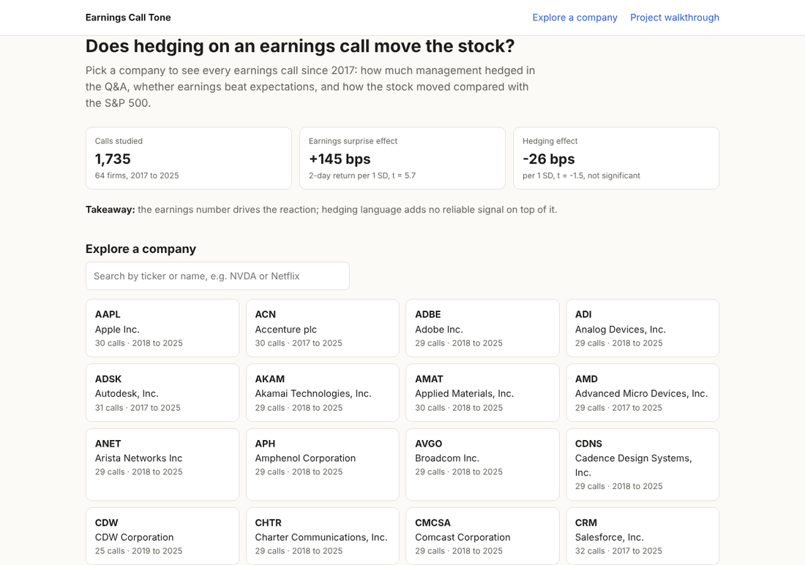
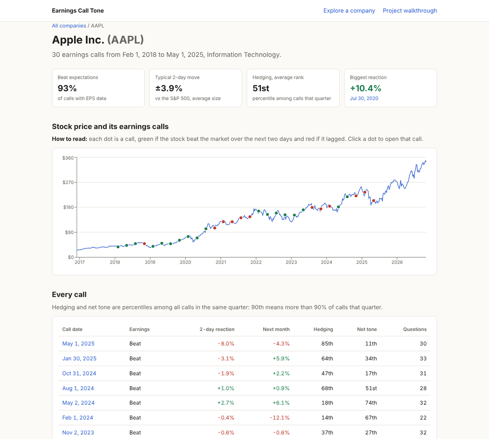
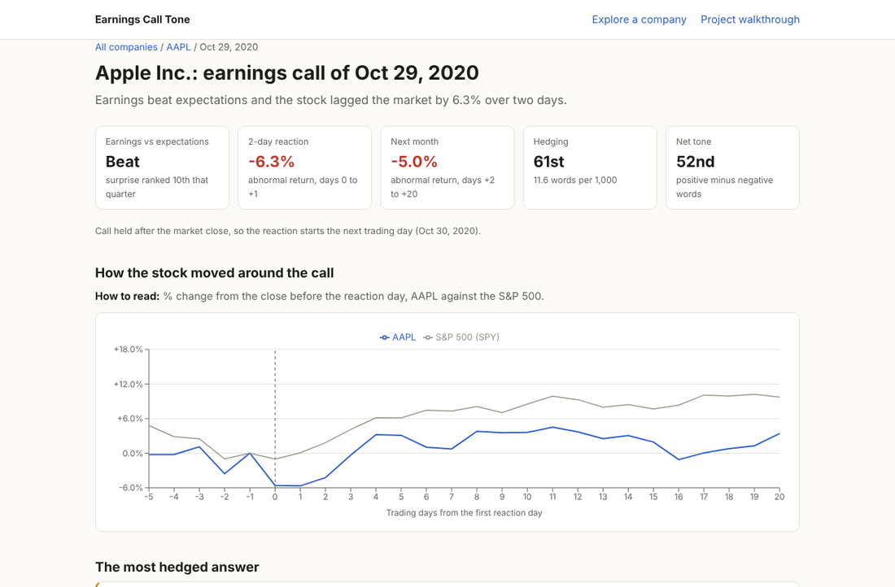
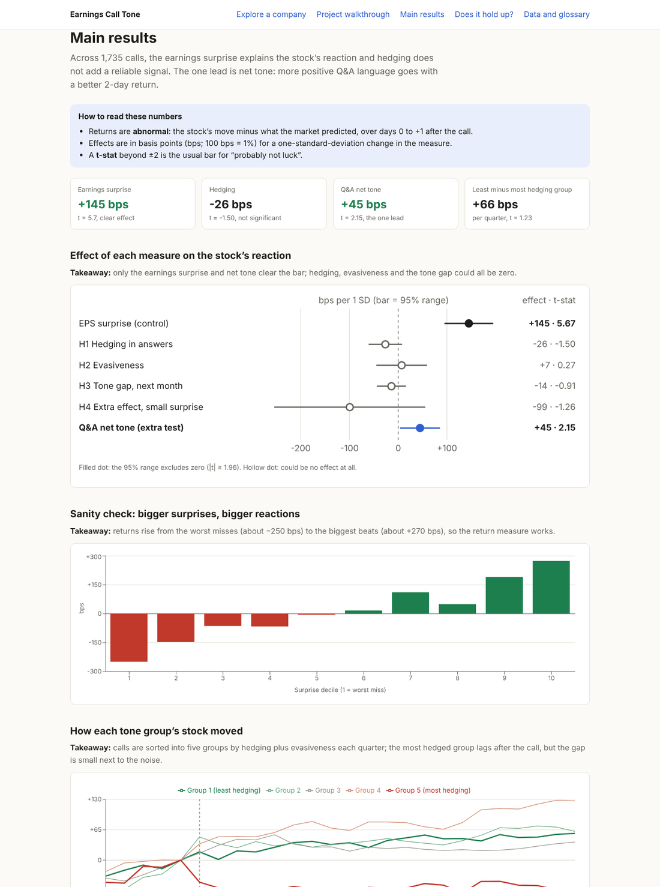
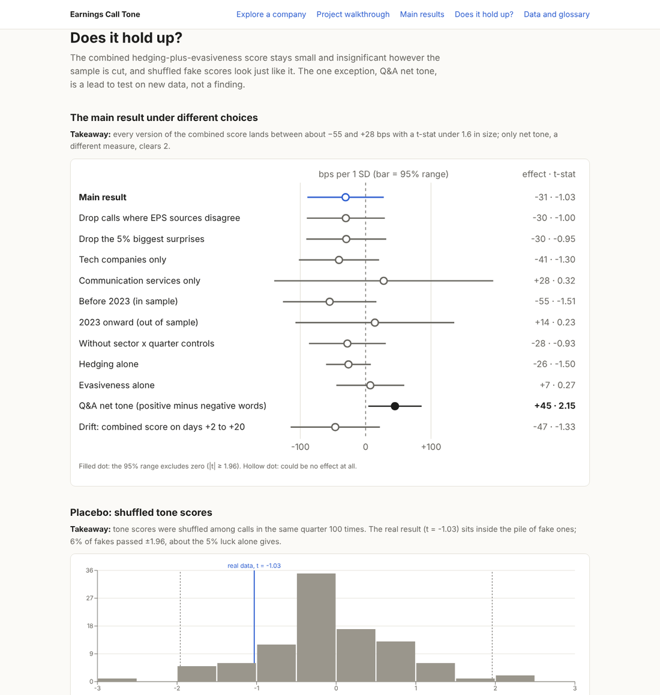

# Earnings Tone

Does *how* management talks in the Q&A of an earnings call (hedging, uncertainty, evasive answers) predict the stock's abnormal return after the call, beyond the EPS surprise?

This repo holds the research pipeline and a web app built on top of it: a FastAPI service over a SQLite database, and a static Next.js site with a page for every company and every call.



## Findings

1,735 calls from 64 S&P 500 tech and communication services firms, December 2017 to May 2025. Effects are per one standard deviation, on the two-day abnormal return CAR[0,+1], with sector × quarter fixed effects and firm-clustered errors:

| Signal | Effect | t-stat |
| --- | --- | --- |
| EPS surprise (SUE) | +145 bps | 5.7 |
| Q&A net tone | +45 bps | 2.15 |
| Q&A hedging | -26 bps | -1.50 |
| Evasiveness | +7 bps | 0.27 |

Bottom line: the EPS surprise dominates. Hedging and evasiveness add no reliable signal, the least-minus-most-hedged quintile spread fades from 94 bps (2018 to 2022) to 10 bps (2023 onward), and 100 placebo shuffles look like the real result. Q&A net tone is the one lead worth testing on new data.

## The app

| Page | What it shows |
| --- | --- |
| Explore a company | Search 66 companies; each has a weekly price chart with a dot per call and a table of every call |
| Call page | Beat or miss, 2-day and next-month abnormal return, stock vs S&P 500 from day -5 to +20, the most hedged answer, all Q&A excerpts |
| Project walkthrough | Hypotheses, verdicts and the 10 steps of the study |
| Main results | Effect sizes, surprise-decile sanity check, returns by tone group, spread by quarter, tone over time |
| Does it hold up? | 12 robustness checks, placebo test, full regression table |
| Data and glossary | Sample flow, method, glossary, caveats, sources |

| Company | Call |
| --- | --- |
|  |  |

| Main results | Does it hold up? |
| --- | --- |
|  |  |

## Layout

| Folder | What it holds |
| --- | --- |
| `pipeline/` | `earnings_tone` Python package (parse transcripts, score tone, event study), scripts for the real-data run, 12 tests |
| `db/` | SQLite schema (8 tables) |
| `api/` | Read-only FastAPI service with 10 endpoints, 8 tests, and `export_static.py` for the site |
| `web/` | Static Next.js site, about 1,900 pages |

CI runs the pipeline tests, the synthetic demo, the API tests and a site typecheck on every push.

## Running it

```bash
# 1. pipeline: tests and a synthetic end-to-end run, no downloads
cd pipeline && pip install -r requirements.txt -e .
python -m pytest -q
python -m earnings_tone.cli demo

# 2. database from the real-data outputs (inputs listed in the script's docstring), about 1 minute
python scripts/build_db.py FEATURES PANEL PRICES TRANSCRIPTS LM_DICT RESULTS_DIR ../data/earnings_tone.sqlite

# 3. API at http://127.0.0.1:8000/docs
cd ../api && pip install -r requirements.txt
EARNINGS_TONE_DB=../data/earnings_tone.sqlite uvicorn app.main:app --reload

# 4. site at http://localhost:3000
EARNINGS_TONE_DB=../data/earnings_tone.sqlite python export_static.py ../web/data
cd ../web && npm install && npm run dev
```

The real-data run itself is described in [pipeline/README.md](pipeline/README.md) and the docstrings in `pipeline/scripts/`.

## Data

No data is committed. Transcripts come from the Hugging Face dataset `kurry/sp500_earnings_transcripts`, prices from Yahoo Finance, and EPS surprise from public Hugging Face datasets, one of which (`sovai/earnings_surprise`) is licensed for academic research only. The app shows derived values only (tone scores, abnormal returns, beat or miss, a surprise percentile) and short Q&A excerpts, never raw licensed data or full transcripts.
