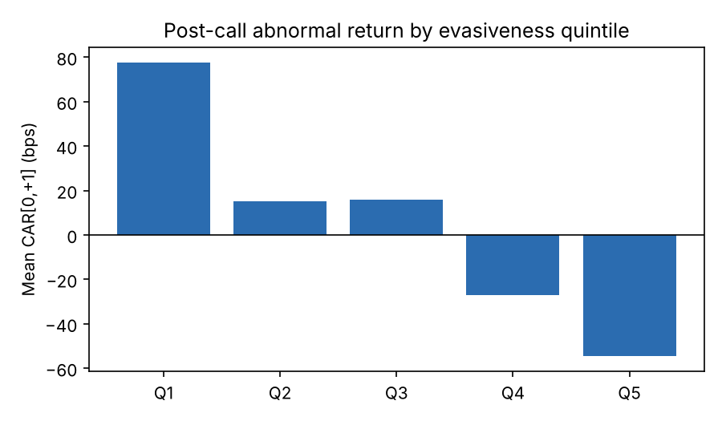
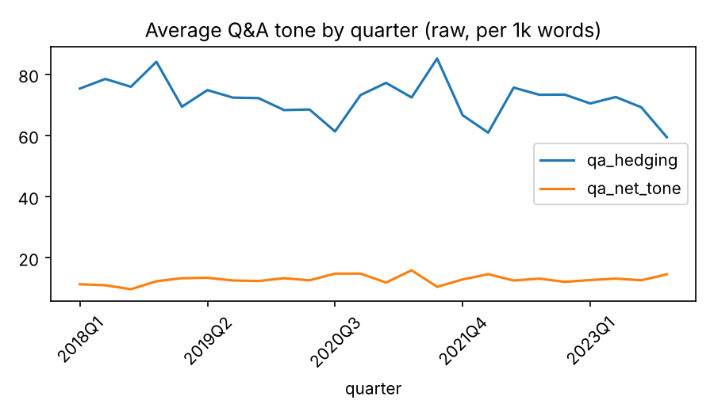

# Earnings Call Tone Study: Results

Calls: **1,440** | Firms: **60** | Quarters: **24**

## Regressions (firm-clustered SE, sector x quarter FE)

| Spec | Variable | Coef (bps per 1 SD) | t-stat | N | R2 |
|---|---|---|---|---|---|
| H1_hedging | `z_qa_hedging` | -46.5 | -8.06 | 1440 | 0.584 |
| H1_hedging | `z_sue` | 245.7 | 38.09 | 1440 | 0.584 |
| H2_evasion | `z_evasion` | -52.0 | -8.24 | 1440 | 0.587 |
| H3_tone_gap_drift | `z_tone_gap` | -11.5 | -0.64 | 1440 | 0.047 |
| H4_low_sue_interaction | `z_composite` | -48.8 | -5.57 | 1440 | 0.588 |
| H4_low_sue_interaction | `z_composite:low_sue` | -12.9 | -1.04 | 1440 | 0.588 |

## Quintile portfolio (Q1 cleanest minus Q5 most evasive, CAR[0,+1])

| Period | Mean spread (bps) | t-stat | Quarters | Hit rate |
|---|---|---|---|---|
| Full sample | 132.4 | 5.26 | 24 | 92% |
| In sample (< 2020Q1) | 143.0 | 3.27 | 8 | 88% |
| Out of sample (>= 2020Q1) | 127.1 | 4.01 | 16 | 94% |

## Placebo (tone shuffled within quarter)

`z_composite` coef: 11.1 bps, t = 1.77 (should be near zero)

